# I-DocAssistance (DocBook) — Project Documentation

A multi-clinic, bilingual (English / Urdu) **AI appointment assistant**. Patients talk to a chat or voice bot to book, cancel, reschedule and look up appointments, doctors, clinic info and prescriptions. Clinic staff and doctors manage everything through an admin panel and a doctor portal.

> Naming note: the repo is called **DocBook**; the code, API title, DB comments and UI keys use **I-DocAssistance**. They are the same product.

---

## 1. Features at a glance

| Audience | Capability |
|---|---|
| **Patient** | Text chat and voice chat (browser speech recognition in, ElevenLabs / browser TTS out); book, cancel, reschedule; check appointment status; view prescriptions; FAQs; doctor and clinic info; emergency detection; English + Urdu (script and Roman Urdu); "My Appointments" page; public reviews page; thumbs up/down feedback on replies |
| **Admin / staff** | Dashboard, doctor day-view calendar, appointment list, doctors (add-doctor wizard, weekly availability, leaves), patients and patient detail, FAQs, clinics, billing, reports, analytics, waitlist and reviews moderation, conversation transcripts, doctor assignment, settings (email, general, message templates), clinic onboarding wizard |
| **Doctor** | Separate login, own schedule and appointments, write prescriptions / medical records, reschedule / cancel, enable telemedicine |
| **System** | Multi-tenant (everything is scoped by `clinic_id`), in-app notifications, email confirmations and reminders, slot generation, double-booking protection, theme colour picker, i18n |

Demo assets (video walkthrough and LinkedIn carousel) live in [`demo/`](demo/).

---

### Screenshots

**Voice chat (Urdu booking conversation)**

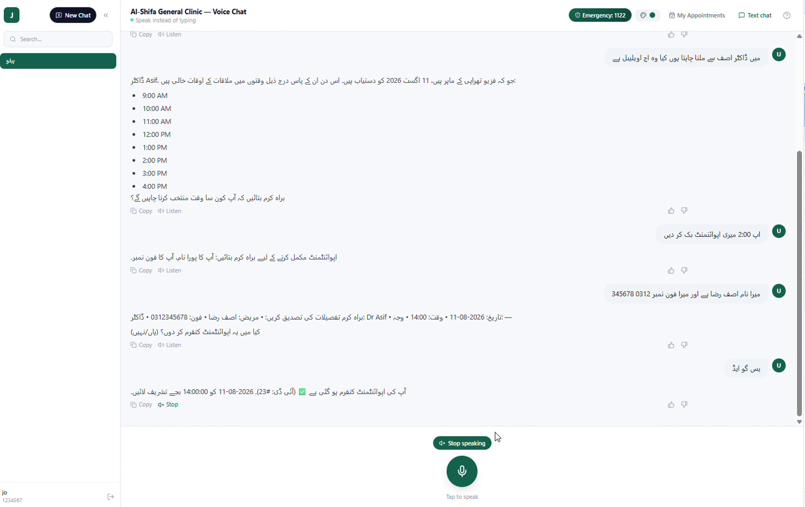

**Admin dashboard**

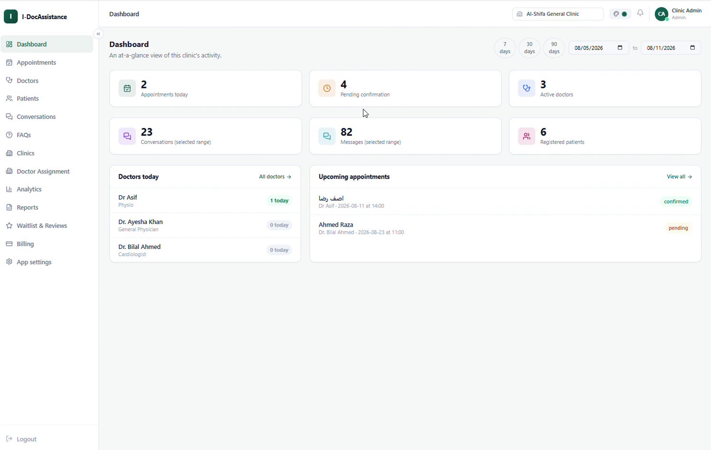

**Doctor day view and calendar**

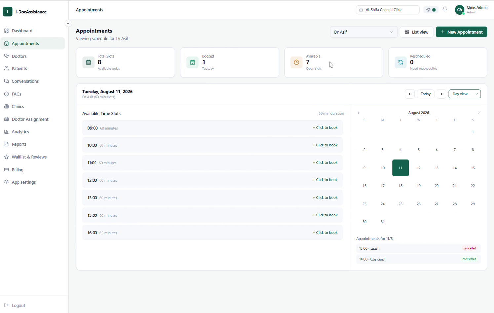

**Appointments list**

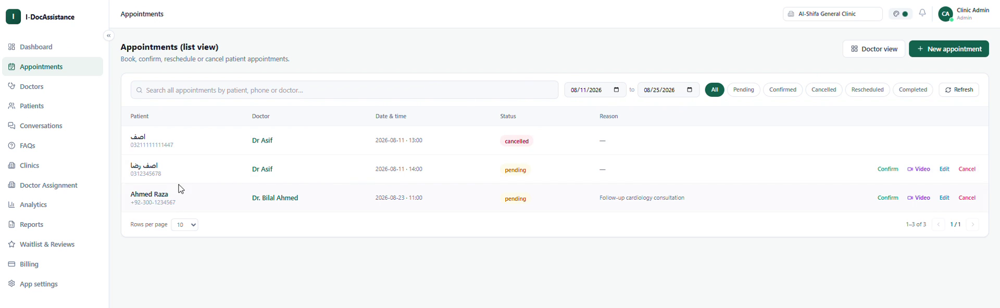

**Analytics**

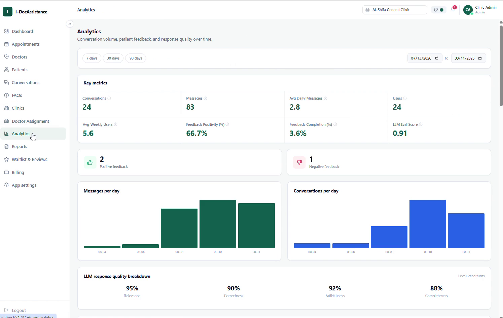

**Doctor portal**

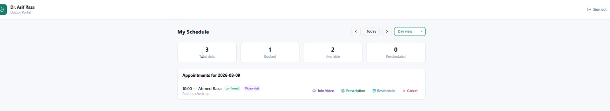

---

## 2. Tech stack

| Layer | Technology |
|---|---|
| Frontend | React 18, TypeScript, Vite 5, Tailwind CSS 3, react-router-dom 7, axios, i18next (en/ur), react-markdown, lucide-react |
| Backend | Python 3.12, FastAPI, Uvicorn, pydantic-settings, asyncpg (raw SQL, **no ORM**), PyJWT, bcrypt |
| AI orchestration | **LangGraph** `StateGraph` (deterministic node pipeline) |
| LLM | Azure OpenAI (`AsyncAzureOpenAI`, light model deployment, e.g. `gpt-5.4-nano`) |
| Voice | Browser Web Speech API (STT) + ElevenLabs (TTS), browser TTS fallback |
| Database | PostgreSQL (schemas `public` and `chat`) |
| Email | SMTP (Gmail by default) |
| Packaging | Dockerfiles for backend and frontend |

---

## 3. System architecture

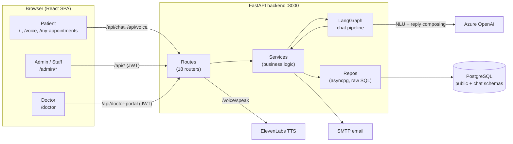

Request path in dev: browser → Vite dev server (`:5173`) → proxy `/api/*` (prefix stripped) → FastAPI (`:8000`).

### Layering (backend)

```
routes/     HTTP + validation (Pydantic), thin
services/   business rules, orchestration, emails, notifications
repo/       data access (asyncpg pools, one repo per table)
graph/      LangGraph chat pipeline (nodes, router, prompts, state, llm client)
core/       config, deps (JWT guard), logging, pagination
```

* `repo/sql_connector.py` creates a **write pool** and an optional **read pool** (read replica via `POSTGRES_READ_HOST`) with connect retries, opened/closed in the FastAPI lifespan.
* A global exception handler logs the full traceback server-side and returns a generic 500 (traceback only when `DEBUG=true`). A middleware logs method, path, status and latency of every request.

---

## 4. The chat flow (the core of the product)

### 4.1 One chat turn, end to end

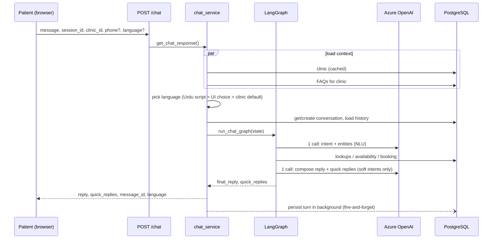

Design choices worth knowing:

* **Deterministic graph, LLM only where it adds value.** The LLM classifies intent and extracts entities (one merged call), and writes friendly prose for informational intents. Everything with consequences (validation, availability, confirmation, booking, cancel, reschedule) is plain code.
* **Latency:** NLU is a single LLM call; clinic + FAQ loads run concurrently; critical replies (booking confirmation, appointment IDs, emergency) are deterministic strings that skip the LLM; the turn is persisted after the reply is returned.
* **Fail-fast LLM client:** 15 s timeout, 1 retry.
* **History** is stored one row per *turn* (patient text + bot reply) and expanded back into `[{role, content}]` pairs for the prompts.

### 4.2 The LangGraph pipeline

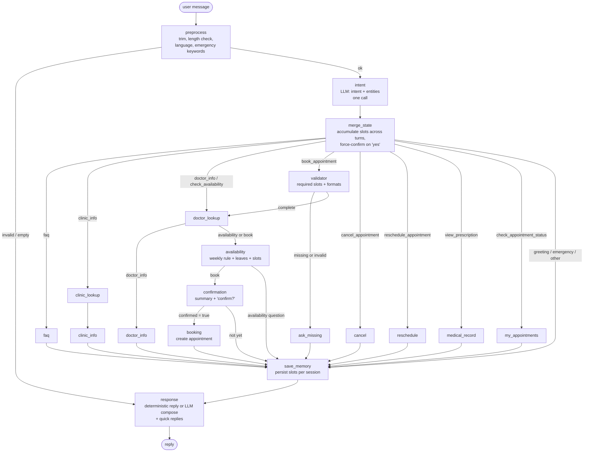

Source of truth: [`backend/app/graph/graph.py`](backend/app/graph/graph.py) (wiring) and [`router.py`](backend/app/graph/router.py) (all conditional edges).

### 4.3 Nodes

| Node | File | Responsibility |
|---|---|---|
| `preprocess` | `nodes/preprocess.py` | Trim input, reject empty / over-long (>4000 chars) messages, detect language, keyword-based **emergency** detection (EN, Roman Urdu, Urdu script) |
| `intent` | `nodes/intent.py` | One LLM call returning the intent label **and** extracted entities; skipped when preprocess already decided; entities dropped for greeting / emergency / clinic-info |
| `merge_state` | `nodes/merge_state.py` | Multi-turn **slot filling**: overlays new entities on remembered slots; deterministic backstop: a short unambiguous "yes / haan ji" forces `confirmed=true` and `intent=book` |
| `validator` | `nodes/validator.py` | Required booking slots present (name, phone, doctor *or* specialty, date, time); phone / date / time / email format checks |
| `ask_missing` | `nodes/ask_missing.py` | Deterministic bilingual prompt for missing / invalid fields |
| `doctor_lookup` | `nodes/doctor_lookup.py` | Resolve the requested doctor / specialty to a record |
| `availability` | `nodes/availability.py` | Check weekly rule, one-off leaves and generated slots; reports alternatives when unavailable |
| `confirmation` | `nodes/confirmation.py` | Builds booking summary and asks "confirm?"; turn ends until the patient affirms |
| `booking` | `nodes/booking.py` | Calls `appointment_service.book_appointment`; handles `SlotUnavailableError`; clears per-booking slots |
| `cancel` / `reschedule` | `nodes/cancel.py`, `reschedule.py` | Patient-owned appointment changes |
| `medical_record` | `nodes/medical_record.py` | Phone-verified prescription / report lookup |
| `my_appointments` | `nodes/my_appointments.py` | Status of the patient's appointments |
| `faq`, `doctor_info`, `clinic_lookup`, `clinic_info` | `nodes/*.py` | Build structured `response_payload` for informational answers |
| `save_memory` | `nodes/save_memory.py` | Persist slots by `session_id` (see §10 caveat) |
| `response` | `nodes/response.py` | Deterministic reply, or one LLM call composing reply + quick replies; fixed emergency numbers (`1122 / 115`) |

### 4.4 Intents

`book_appointment`, `cancel_appointment`, `reschedule_appointment`, `check_availability`, `doctor_info`, `clinic_info`, `faq`, `view_prescription`, `check_appointment_status`, `greeting`, `emergency`, `other` (+ internal `invalid`). Defined in `graph/constants.py`.

### 4.5 Conversation state (`ChatState`)

Context (`clinic_id`, `session_id`, `lang`, `clinic`, `faqs`, `history`, `patient_phone`) → NLU (`intent`, `entities`, `slots`) → validation (`missing_fields`, `validation_error`) → lookups (`matched_doctor`, `doctors`, `availability`, `medical_records`) → actions (`needs_confirmation`, `action_result`, `action_error`) → output (`response_payload`, `final_reply`, `quick_replies`). Each node returns only the keys it owns.

### 4.6 Example: booking dialogue

```
Patient : I need a dentist tomorrow at 5pm
Bot     : (validator → missing name, phone)  "May I have your full name and phone number?"
Patient : Ali Khan, 0300-1234567
Bot     : (availability OK → confirmation)
          "Dr. X, <date> 17:00, for Ali Khan. Shall I confirm? (yes/no)"
Patient : yes
Bot     : (merge_state forces confirmed → booking)  "Booked! Appointment ID #123"
```

### 4.7 Voice flow

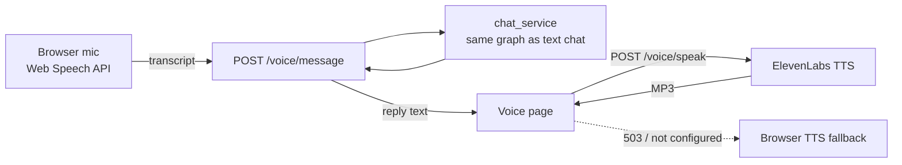

### 4.8 Booking lifecycle (state diagram)

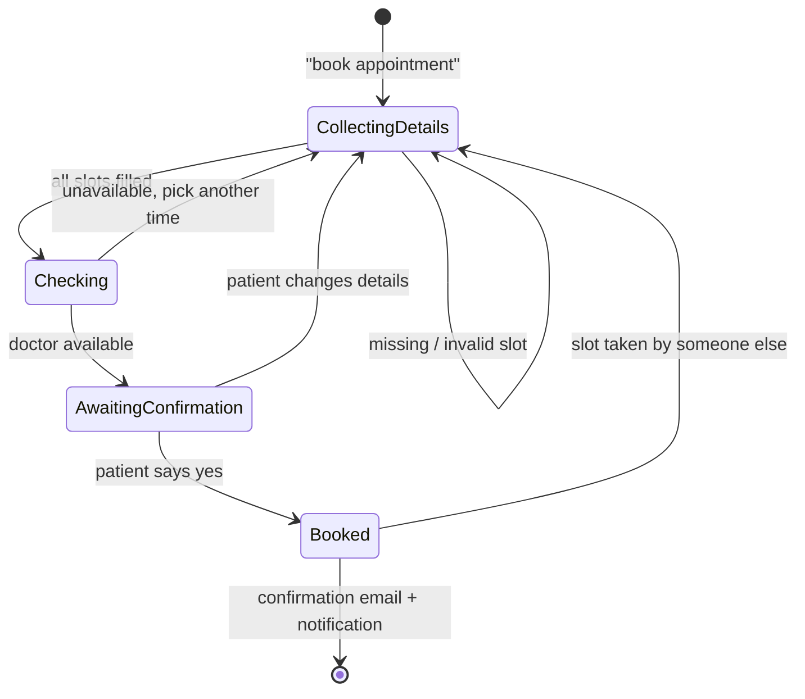

---

## 5. Appointment & availability model

Availability combines three sources (`services/availability_service.py`):

1. **Weekly rule** – `doctor_availability` (recurring day-of-week windows, slot length).
2. **Leaves** – `doctor_leaves` (one-off days off that override the rule).
3. **Generated slots** – `doctor_slots`, pre-generated (`POST /doctors/{id}/slots/generate`, default 30 days ahead); booking *claims* a slot.

If two patients race for the same slot, the loser gets `SlotUnavailableError` and the bot asks for another time instead of double-booking. Patients who find no slot can join the **waitlist**.

After a booking: patient record is resolved-or-created, a confirmation email is sent (templates configurable per clinic), staff get an in-app notification, and reminders can be dispatched via `POST /appointments/send-reminders`.

---

## 6. Data model (PostgreSQL)

DDL: [`backend/db/schema.sql`](backend/db/schema.sql) · sample data: [`backend/db/seed_data.sql`](backend/db/seed_data.sql). Every table ends with the same four timestamps (`server_*` UTC, `local_*` clinic-local).

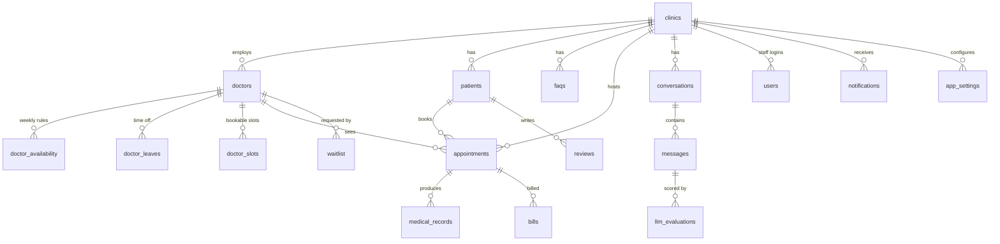

Tables: `users`, `clinics`, `doctors`, `doctor_availability`, `doctor_leaves`, `doctor_slots`, `patients`, `faqs`, `appointments`, `waitlist`, `reviews`, `medical_records`, `bills`, `conversations`, `messages`, `llm_evaluations`, `app_settings`, `notifications`.

---

## 7. Frontend

Routes (`frontend/src/App.tsx`):

| Route | Page |
|---|---|
| `/` | Patient chat (`ChatPage`) with login, sidebar of past sessions, quick replies, clinic selector |
| `/voice` | Voice chat |
| `/my-appointments` | Patient's appointments |
| `/book/:slug` | Public per-clinic booking link → chat |
| `/reviews/:slug` | Public reviews |
| `/onboarding` | New-clinic onboarding wizard |
| `/doctor/login`, `/doctor` | Doctor portal |
| `/admin/*` | `dashboard`, `appointments` (doctor day view), `appointments/list`, `doctors`, `patients(/:id)`, `faqs`, `clinics`, `analytics`, `conversations`, `reports`, `waitlist-reviews`, `doctor-assignment`, `billing`, `settings` |

State is held in React contexts: `ClinicContext`, `ThemeContext`, `NotificationContext`, `AdminAuthContext`, `DoctorAuthContext`. `services/api.ts` wraps axios (`baseURL: /api`) and attaches the JWT from `localStorage`; a 401 clears the token. Locales: `locales/en.json`, `ur.json` (RTL-aware).

---

## 8. REST API overview

Interactive docs at `http://localhost:8000/docs`. Prefixes:

| Prefix | Purpose |
|---|---|
| `/chat` | `POST` chat turn · `GET /history` · `GET /conversations` · `POST /feedback` |
| `/voice` | `POST /message` · `POST /speak` |
| `/auth` | `POST /login` · `POST /register` · `GET /me` |
| `/clinics`, `/doctors`, `/patients`, `/faqs` | CRUD (+ search, pagination, `with-availability`) |
| `/doctors/{id}/availability`, `/leaves`, `/slots` | Schedule management, slot generation |
| `/appointments` | CRUD, `/mine/*` (patient self-service), `/doctor-day-schedule`, `/send-reminders` |
| `/doctor-portal` | Doctor schedule, appointments, prescriptions, reschedule / cancel / telemedicine |
| `/medical-records`, `/bills`, `/waitlist`, `/reviews` | Clinical, billing, waitlist, review features |
| `/conversations`, `/analytics`, `/notifications`, `/settings` | Admin tooling and configuration |
| `/health` | Liveness probe |

---

## 9. Setup & run

**Prerequisites:** Python 3.12, Node 20, PostgreSQL, an Azure OpenAI deployment.

```powershell
# 1. Database
psql -U <user> -d <db> -f backend/db/schema.sql
psql -U <user> -d <db> -f backend/db/seed_data.sql      # optional sample data

# 2. Backend
cd backend
python -m venv venv ; .\venv\Scripts\Activate.ps1
pip install -r requirements.txt
copy .env.example .env      # then fill in values (see below)
uvicorn app.main:app --reload     # http://localhost:8000/docs

# 3. Frontend
cd ../frontend
npm install
npm run dev                       # http://localhost:5173
```

### Environment variables (`backend/.env`)

| Variable | Notes |
|---|---|
| `POSTGRES_HOST`, `POSTGRES_PORT`, `POSTGRES_DB`, `POSTGRES_USER`, `POSTGRES_PASSWORD` | Primary DB (DB and USER are required) |
| `POSTGRES_READ_HOST` | Optional read replica |
| `POSTGRES_SCHEMA` / `POSTGRES_CHAT_SCHEMA` | Default `public` / `chat` |
| `DB_POOL_MIN_SIZE` / `DB_POOL_MAX_SIZE` | Default 2 / 10 |
| `AZURE_OPENAI_ENDPOINT_SM`, `AZURE_OPENAI_KEY_SM`, `AZURE_OPENAI_MODEL_SM`, `AZURE_OPENAI_PREVIEW_API_VERSION_SM` | Azure OpenAI; model = **deployment name** |
| `ELEVENLABS_API_KEY`, `ELEVENLABS_VOICE_ID` | Optional TTS |
| `MAIL_USERNAME`, `MAIL_PASSWORD`, `MAIL_FROM`, `MAIL_SERVER`, `MAIL_PORT` | SMTP |
| `JWT_SECRET`, `JWT_ALGORITHM`, `JWT_EXPIRE_MINUTES` | Auth tokens (default 7 days) |
| `CORS_ALLOWED_ORIGINS` | `*` or comma-separated list |
| `DEBUG`, `LOG_LEVEL` | Diagnostics |

Docker: `backend/Dockerfile` (python:3.12-slim, uvicorn :8000) and `frontend/Dockerfile` (node:20-alpine, Vite dev server :5173).

---

## 10. Repository layout

```
DocBook-SourceCode-main/
├─ README.md
├─ PROJECT.md                 ← this file
├─ idoc-end-user-guide.docx
├─ idoc-technical-guide.docx
├─ demo/                      ← demo video, LinkedIn carousel (merged from DocBook-Demo)
├─ backend/
│  ├─ app/
│  │  ├─ main.py              FastAPI app, middleware, router registration
│  │  ├─ core/                config, deps, logging, pagination
│  │  ├─ routes/              HTTP endpoints
│  │  ├─ services/            business logic, email, TTS, auth
│  │  ├─ repo/                asyncpg repositories
│  │  ├─ models/              data model definitions
│  │  └─ graph/               LangGraph pipeline (nodes/, prompts/, router, state, llm)
│  ├─ db/                     schema.sql, seed_data.sql
│  ├─ Dockerfile, requirements.txt, .env.example
└─ frontend/
   └─ src/ (pages/, components/, context/, services/, locales/, hooks/, utils/)
```

---

## 11. Known issues & recommended hardening

Found while reviewing the code — worth fixing before any real deployment:

1. **Hard-coded ElevenLabs API key** is the default value in `backend/app/core/config.py`. Remove the default, **rotate that key**, and supply it only through `.env`.
2. **Weak default `JWT_SECRET`** (`dev-only-change-me-in-production`) — require it via env in production.
3. **Open endpoints.** Only some routes use the JWT guard; `/auth/register` is open and the backend README notes auth was removed from other routes. Anyone reaching the API can create or edit clinics, doctors, FAQs and appointments. Add role-based guards (admin / doctor / patient) and lock down `/auth/register`.
4. **Slot memory is in-process** (`save_memory.py` uses a module-level dict): lost on restart and not shared across workers. Back it with Redis or a DB table before running more than one worker.
5. **Patient identity is phone-only** (no OTP); anyone knowing a number can view that patient's appointments and prescriptions via `/mine` and `/medical-records/lookup`. Add OTP verification.
6. **Docs drift:** `backend/README.md` describes SQLModel / `DATABASE_URL`, while the code uses asyncpg with `POSTGRES_*` settings; `.env.example` is likewise outdated and should be aligned with §9. Naming (`DocBook` vs `I-DocAssistance`) is mixed.
7. Open items in `backend/todo.txt`: doctor email and WhatsApp notifications after booking, concurrency handling, admin lock by credentials, multilingual admin panel, voice input.

---

## 12. Related documents

* `idoc-end-user-guide.docx` — end-user manual
* `idoc-technical-guide.docx` — technical guide
* `demo/I-DoctorAssistance Demo.mp4` — product walkthrough
* `demo/idoc-linkedin-carousel.pdf` — marketing carousel
