# DocBook (I-DocAssistance)

A multi-clinic, bilingual (English / Urdu) **AI appointment assistant**. Patients use a chat or voice bot to book, cancel and reschedule appointments, check doctors, clinic info and FAQs, and view prescriptions. Clinic staff manage everything from an admin panel, and doctors have their own portal.

> The repo is called **DocBook**; the code, API title and UI keys say **I-DocAssistance**. Same product.

Full deep-dive: [PROJECT.md](PROJECT.md) · Demo video and carousel: [demo/](demo/)

---

## Features

| Audience | Capabilities |
|---|---|
| **Patient** | Text and voice chat, book / cancel / reschedule, appointment status, prescriptions, FAQs, doctor and clinic info, emergency detection, English + Urdu (script and Roman Urdu), "My Appointments", public reviews, reply feedback |
| **Admin / staff** | Dashboard, doctor day-view calendar, appointments, doctors (wizard, weekly availability, leaves), patients, FAQs, clinics, billing, reports, analytics, waitlist and reviews, conversation transcripts, settings, onboarding wizard |
| **Doctor** | Own login, schedule, appointments, prescriptions, reschedule / cancel, telemedicine |
| **System** | Multi-tenant (`clinic_id` everywhere), notifications, email confirmations and reminders, slot generation, double-booking protection, themes, i18n |

## Screenshots

**Voice chat (Urdu booking conversation)**

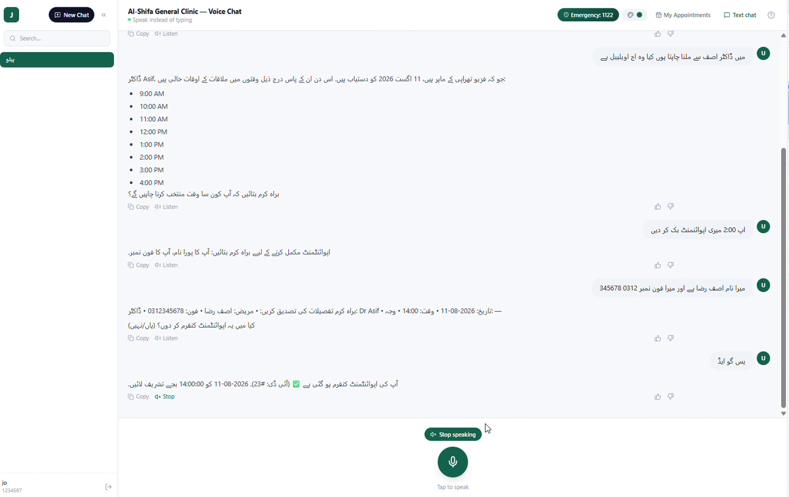

**Admin dashboard**

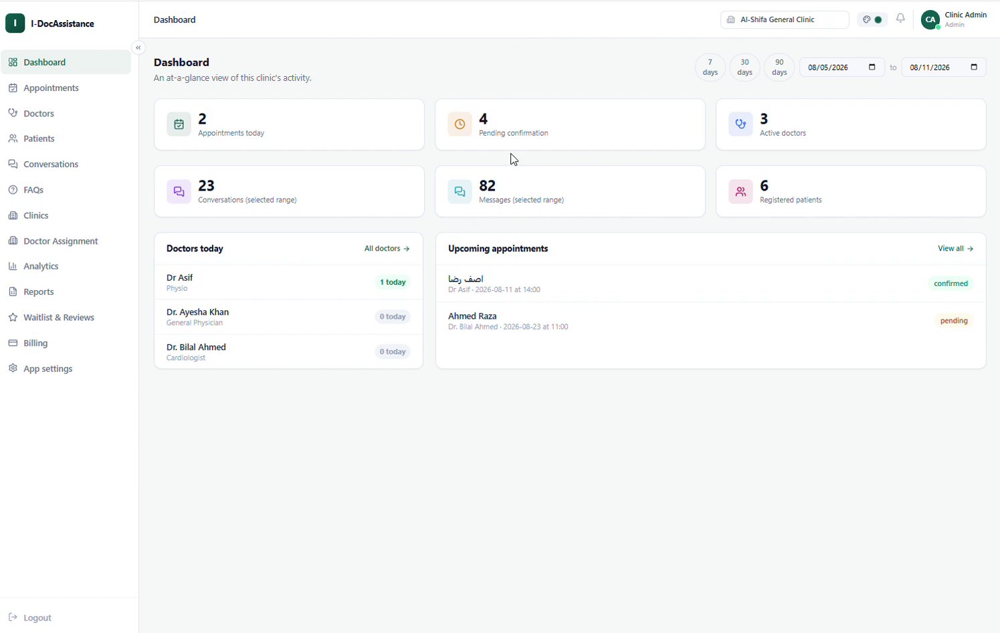

**Doctor day view and calendar**

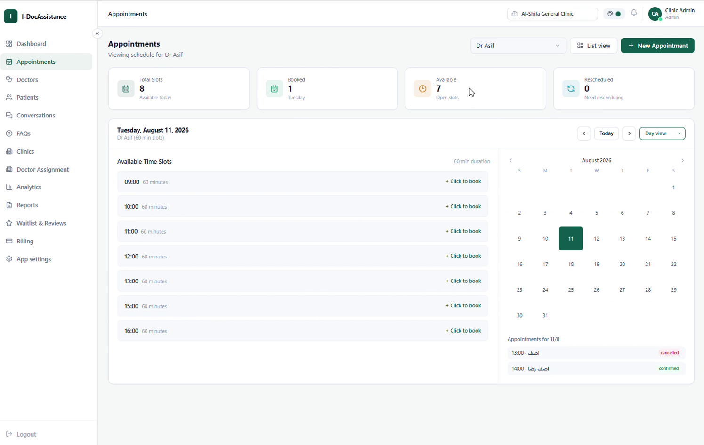

**Appointments list**

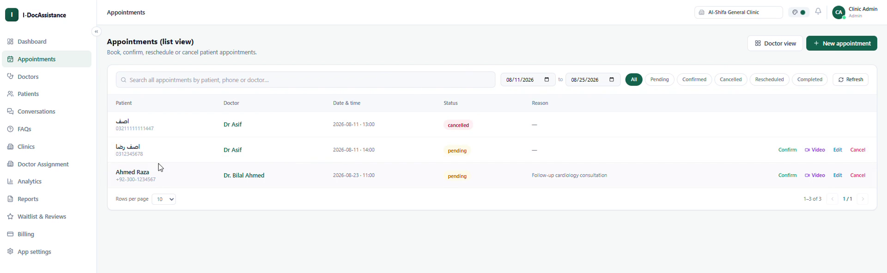

**Analytics**

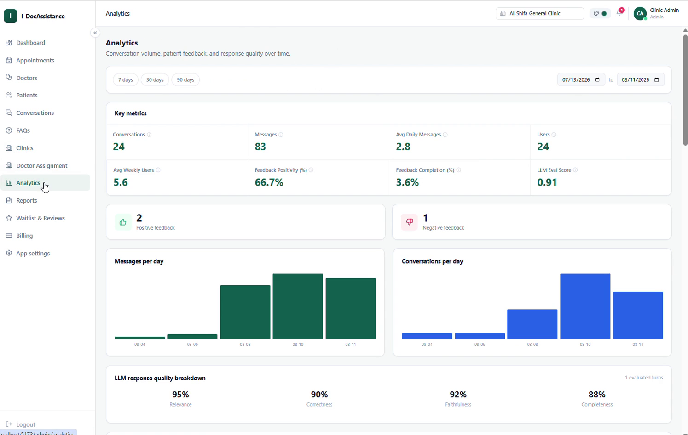

**Doctor portal**

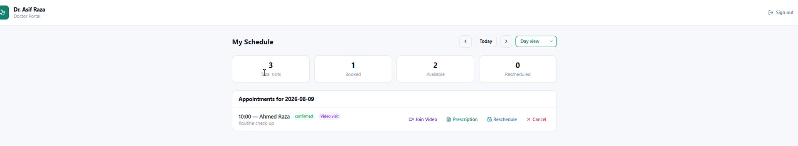

## Tech stack

| Layer | Technology |
|---|---|
| Frontend | React 18, TypeScript, Vite, Tailwind CSS, react-router, axios, i18next |
| Backend | Python 3.12, FastAPI, asyncpg (raw SQL), PyJWT, bcrypt |
| AI | LangGraph deterministic pipeline + Azure OpenAI |
| Voice | Browser Web Speech API (STT), ElevenLabs (TTS) with browser-TTS fallback |
| Data | PostgreSQL |
| Email | SMTP |

---

## Architecture

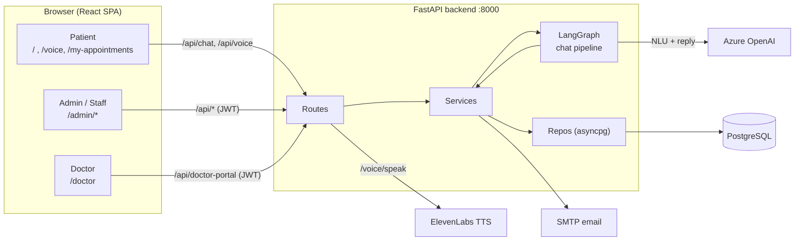

Backend layers: `routes/` (HTTP) → `services/` (business rules) → `repo/` (SQL) and `graph/` (chat pipeline). In dev, Vite proxies `/api/*` to FastAPI on port 8000.

---

## Chat flow

### One turn

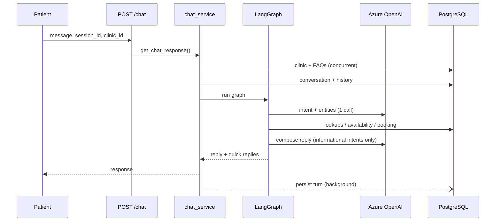

### LangGraph pipeline

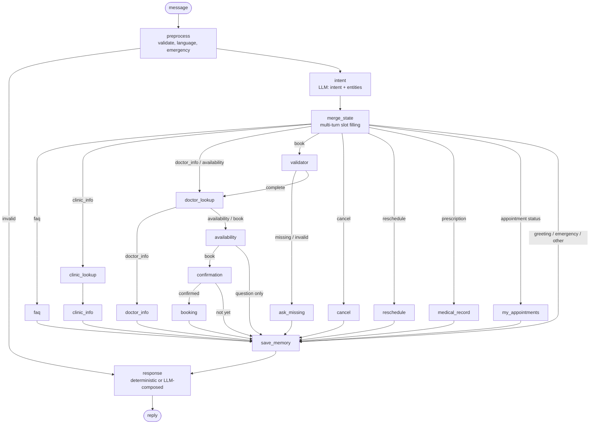

Key ideas: the LLM only classifies intent and writes friendly prose. Validation, availability, confirmation and booking are plain code, and critical replies (booking IDs, emergencies) never go through the LLM. Wiring lives in `backend/app/graph/graph.py` and `router.py`.

### Voice flow

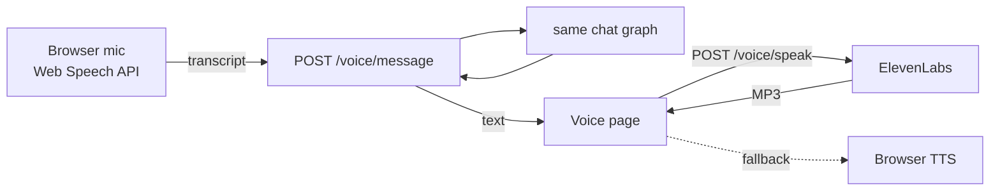

### Booking lifecycle

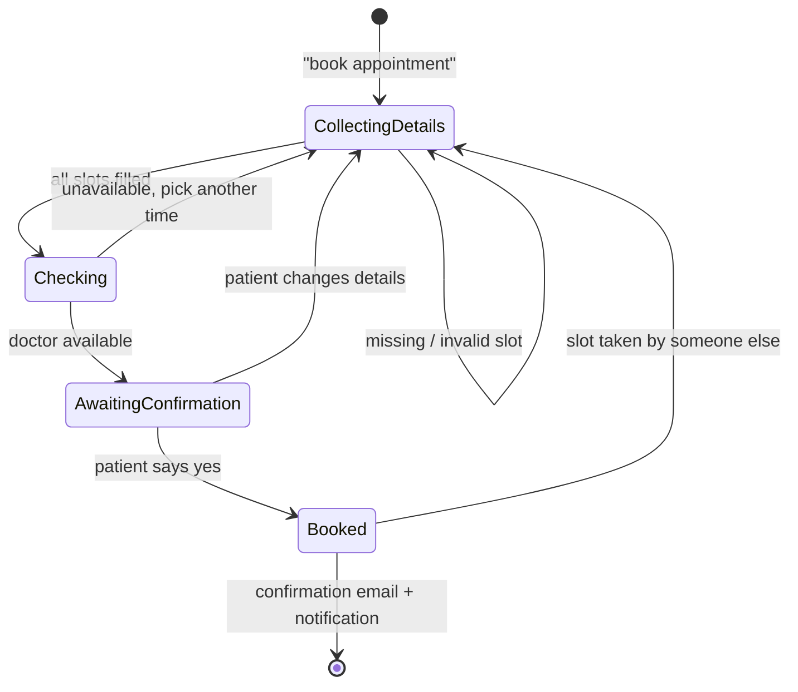

---

## Data model (ER diagram)

Schema: [backend/db/schema.sql](backend/db/schema.sql) · Sample data: [backend/db/seed_data.sql](backend/db/seed_data.sql)

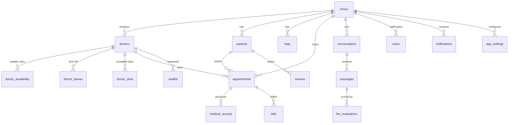

---

## API overview

Interactive docs: `http://localhost:8000/docs`

| Prefix | Purpose |
|---|---|
| `/chat`, `/voice` | Chat turn, history, feedback; voice message and TTS |
| `/auth` | Login, register, me |
| `/clinics`, `/doctors`, `/patients`, `/faqs` | CRUD, search, pagination |
| `/doctors/{id}/availability`, `/leaves`, `/slots` | Schedule management and slot generation |
| `/appointments`, `/doctor-portal` | Appointments, patient self-service (`/mine`), doctor actions |
| `/medical-records`, `/bills`, `/waitlist`, `/reviews` | Clinical, billing, waitlist, reviews |
| `/conversations`, `/analytics`, `/notifications`, `/settings` | Admin tooling |
| `/health` | Liveness probe |

## Frontend routes

`/` chat · `/voice` · `/my-appointments` · `/book/:slug` · `/reviews/:slug` · `/onboarding` · `/doctor/login`, `/doctor` · `/admin/*` (dashboard, appointments, doctors, patients, faqs, clinics, analytics, conversations, reports, waitlist-reviews, doctor-assignment, billing, settings)

---

## Getting started

Prerequisites: Python 3.12, Node 20, PostgreSQL, an Azure OpenAI deployment.

```powershell
# 1. Database
psql -U <user> -d <db> -f backend/db/schema.sql
psql -U <user> -d <db> -f backend/db/seed_data.sql   # optional sample data

# 2. Backend
cd backend
python -m venv venv ; .\venv\Scripts\Activate.ps1
pip install -r requirements.txt
copy .env.example .env     # fill in values
uvicorn app.main:app --reload

# 3. Frontend
cd ../frontend
npm install
npm run dev
```

Backend: http://localhost:8000/docs · Frontend: http://localhost:5173

Key `.env` variables: `POSTGRES_HOST/PORT/DB/USER/PASSWORD`, `AZURE_OPENAI_ENDPOINT_SM`, `AZURE_OPENAI_KEY_SM`, `AZURE_OPENAI_MODEL_SM` (deployment name), `ELEVENLABS_API_KEY`, `MAIL_*`, `JWT_SECRET`, `CORS_ALLOWED_ORIGINS`. Full list in [PROJECT.md](PROJECT.md#9-setup--run).

Docker: `backend/Dockerfile` and `frontend/Dockerfile`.

## Repository layout

```
.
├─ README.md, PROJECT.md
├─ idoc-end-user-guide.docx, idoc-technical-guide.docx
├─ demo/                 demo video + carousel
├─ backend/
│  ├─ app/  core/ routes/ services/ repo/ models/ graph/
│  └─ db/   schema.sql, seed_data.sql
└─ frontend/src/  pages/ components/ context/ services/ locales/
```

## Known issues

* A hard-coded ElevenLabs key is the default in `backend/app/core/config.py`: remove it and rotate the key.
* Default `JWT_SECRET` is weak; several routes (incl. `/auth/register`) are unauthenticated.
* Slot memory between chat turns is an in-process dict (lost on restart, not shared across workers).
* Patient identity is phone-only, with no OTP.
* `backend/README.md` and `.env.example` are outdated versus the code.

Details and fixes: [PROJECT.md §11](PROJECT.md#11-known-issues--recommended-hardening).
